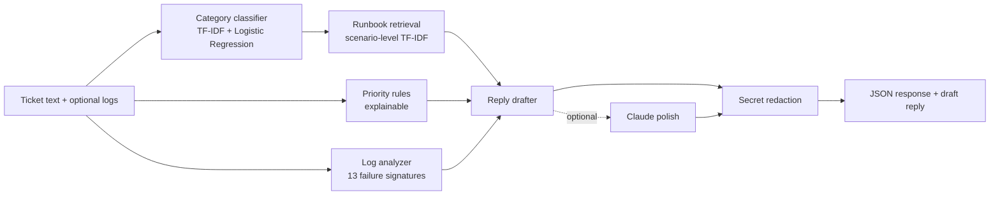

# Cloud Support Copilot

> AI-assisted ticket triage for cloud support teams: classify the ticket, set its priority, find the right runbook scenario, scan logs for known failures and draft a customer reply.


Cloud support engineers spend a large part of every shift reading tickets, deciding who should handle them, looking up the right runbook and asking customers for the same missing details. This project automates that first-response workflow for AWS-style tickets so engineers can spend their time on the actual fix.

## Features

| Capability | How it works |
|---|---|
| **Ticket classification** | TF-IDF + Logistic Regression into 7 categories: compute, storage, networking, IAM/security, billing, database, monitoring |
| **Priority scoring** | Explainable rule engine (critical / high / medium / low) that returns *why* it escalated |
| **Runbook retrieval (RAG-style)** | Scenario-level chunking of 7 runbooks (37 troubleshooting scenarios, 152 steps) with TF-IDF cosine similarity and category-aware boosting |
| **Log analyzer** | 13 failure signatures: Lambda timeouts, OOM kills, `AccessDenied`, 502/503/504, throttling, DNS and TLS errors, ... |
| **Reply drafting** | Template reply with the matched steps, log findings, the info the engineer still needs and an example first-response target |
| **Optional LLM polish** | If `ANTHROPIC_API_KEY` is set, Claude improves the wording using only the retrieved steps; any failure falls back to the template |
| **Safety** | AWS keys and passwords are redacted from echoed log lines, replies and LLM prompts; low-confidence tickets are flagged for human review |

## Architecture



## Quick start

```bash
git clone https://github.com/<your-username>/cloud-support-ai-assistant.git
cd cloud-support-ai-assistant

python -m venv .venv && source .venv/bin/activate      # Windows: .venv\Scripts\activate
pip install -r requirements-dev.txt

python scripts/train.py            # trains the classifier and prints evaluation metrics
uvicorn app.main:app --reload      # API at http://localhost:8000 , interactive docs at /docs
```

### Try it from the command line

```bash
python -m app.cli "Application load balancer returns 502 bad gateway and all targets are unhealthy in production" \
  --subject "ALB 502 errors" --logs sample.log
```

```
Category : Networking (VPC / ELB / Route 53) (confidence 93%)
Priority : HIGH - matched high-impact signal: 'production'
Target   : first response within 1 hour

Please try the following steps:
1. For unhealthy targets verify the health check path, port and expected status code (matcher).
2. The target security group must allow traffic from the ALB security group on the target port.
3. A 502 Bad Gateway means the target closed the connection or sent a malformed response; ...
```

### Or call the API

```bash
curl -s -X POST http://localhost:8000/triage \
  -H "content-type: application/json" \
  -d '{"subject":"S3 upload fails","description":"Getting AccessDenied while uploading a file to my S3 bucket from the CLI"}'
```

| Method | Endpoint | Purpose |
|---|---|---|
| `POST` | `/triage` | Full pipeline: category, priority, runbook steps, log findings, draft reply |
| `POST` | `/analyze-logs` | Log analysis only |
| `GET` | `/kb` | List the runbooks in the knowledge base |
| `GET` | `/health` | Liveness check |

### Docker

```bash
docker build -t cloud-support-copilot .
docker run -p 8000:8000 cloud-support-copilot
```

### Optional: LLM-polished replies

```bash
export ANTHROPIC_API_KEY=your-key        # never commit keys
export LLM_MODEL=claude-sonnet-5-5       # optional, this is the default
# then send "use_llm": true in the /triage request
```

### Tests

```bash
pytest          # 57 tests: classifier, retrieval, priority, log analysis, redaction, API
```

## Evaluation (and its limits)

The training set is **synthetic**: 840 tickets assembled from phrase templates (`scripts/generate_data.py`), because real support tickets are confidential. That makes the usual random-split score misleading, so two numbers are reported by `scripts/train.py`:

| Evaluation | Accuracy | Notes |
|---|---|---|
| Random hold-out of the synthetic data | 100% | Optimistic: test rows come from the same templates |
| **42 hand-written tickets** (`data/eval_tickets.csv`) | **92.9%** | Natural phrasing the model never saw: the number to trust |

Priority scoring is rule-based and has not been benchmarked against real labelled tickets. The knowledge base was written for this project from general AWS knowledge and public documentation concepts; always verify steps against the current AWS documentation before relying on them.

## Project structure

```
app/
  main.py          FastAPI app and routes
  service.py       Orchestrates the whole triage pipeline
  classifier.py    Training + inference for the category model
  priority.py      Rule-based priority with reasons
  retriever.py     Scenario-level runbook retrieval
  log_analyzer.py  Failure-signature scanner
  responder.py     Reply drafting + optional Claude polish
  redact.py        Secret masking
  schemas.py       Pydantic request / response models
  cli.py           Command-line demo
data/
  kb/              7 markdown runbooks (37 scenarios)
  tickets.csv      Synthetic training tickets
  eval_tickets.csv Hand-written evaluation tickets
scripts/           generate_data.py, train.py
tests/             pytest suite
```

## Design decisions

- **Classical ML on purpose.** TF-IDF + Logistic Regression is fast, trains in under a second, runs without a GPU or API key and is easy to explain. An LLM is optional polish, not a dependency.
- **Rules for priority.** Support engineers must be able to see why a ticket was escalated, so every priority comes with the matched signals.
- **Scenario-level chunks.** Retrieving a whole page returned generic steps; chunking runbooks by scenario returns the steps for *this* problem.
- **Fail safe.** Low classifier confidence routes to a human, and the LLM path never blocks a reply.

## Roadmap

- Replace TF-IDF with embeddings (for example Amazon Bedrock Titan or sentence-transformers) and compare on the hand-written set
- Add Azure and GCP runbooks and a provider field
- Feedback loop: let engineers correct the category and retrain
- Deploy on AWS (ECS Fargate or App Runner) with CloudWatch logging

## License

MIT
